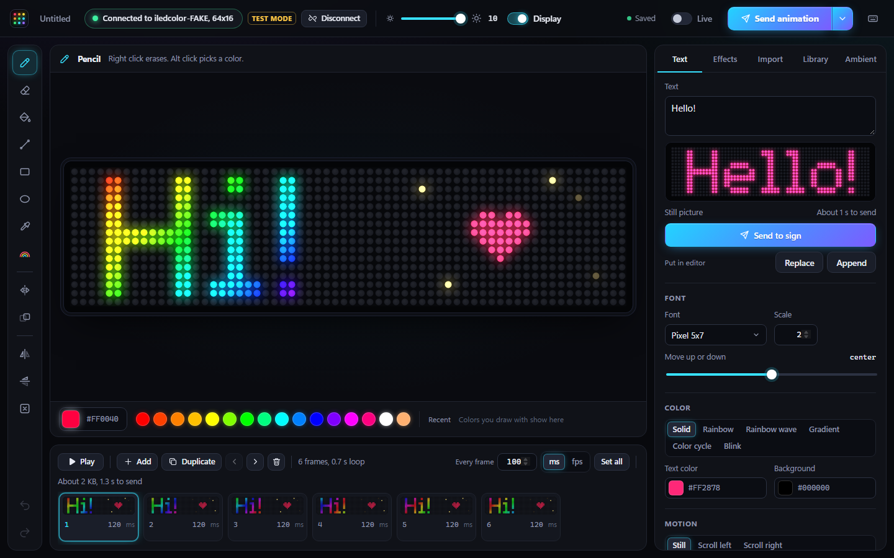
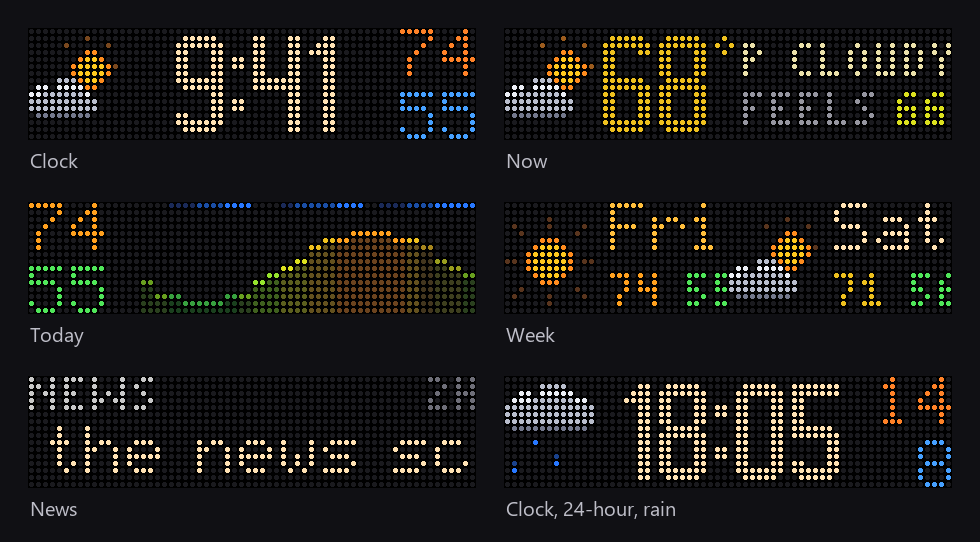

# LED Sign Studio

Draw, animate and send pixel art, text, effects and live weather and news to a cheap iLedColor
Bluetooth LED sign from your Windows PC.



## Features

- **Pixel editor:** pencil, eraser, fill, line, rectangle, ellipse, eyedropper, rainbow brush,
  mirror, flip, undo and redo, on an LED-style canvas sized to your sign.
- **Animations:** a frame timeline with per-frame timing, onion skin and live preview.
- **Text:** pixel fonts or Windows fonts, still or scrolling, with rainbow, gradient and blink.
- **Effects:** rainbow wave, plasma, fire, snow, matrix rain, starfield, fireworks and more, plus
  "animate my drawing" (scroll, pulse, sparkle).
- **Import:** GIF, PNG, JPG and WebP, resized to fit. **Export** to GIF.
- **Library:** your work saves by itself, and you can keep named copies.
- **Live mode:** every edit shows on the sign a moment later.
- **Ambient mode:** a clock, the weather and world headlines on the sign all day, and the sign
  turns off at night. Runs in the background, no window needed.



## Supported hardware

iLedColor Bluetooth LED signs, the ones the iLedColor phone app controls. They show up over
Bluetooth as `iledcolor-XXXX`. Tested on a 64x16 full color sign. The app reads the sign's size
from its Bluetooth advertisement, so other sizes should work in the editor; ambient mode needs
64x16.

## Setup

You need Windows 10 or 11, Python 3.12 or newer, and Bluetooth on the PC. Download or clone this
repository, open a terminal in its folder, and run:

```
python -m venv .venv
.venv\Scripts\pip install -r requirements.txt
```

### Run it in your browser

```
.venv\Scripts\python app\server.py --open
```

It finds the sign by itself and opens the app in your browser. Press Ctrl+C to stop it.

### Or build the desktop app

Install the [.NET 10 SDK](https://dotnet.microsoft.com/download), then:

```
dotnet publish host -c Release -r win-x64 --self-contained false -o LedSignStudio
LedSignStudio\LedSignStudio.exe
```

The first start adds LED Sign Studio to the Start menu and the desktop. To pin it, open it,
right-click its taskbar button and choose **Pin to taskbar**. The app needs the WebView2 runtime,
which Windows 11 already has.

### Ambient mode

Open the **Ambient** tab and search for your city. Then turn on **Start with Windows**: a small
background service starts when you sign in and keeps the clock, weather and news on the sign from
8 AM to 10 PM (you can change the hours, screens and news sources). Nothing runs in the background
until you turn that switch on. Weather comes from [Open-Meteo](https://open-meteo.com), headlines
from the public RSS feeds of world news outlets.

### Try it without a sign

```
.venv\Scripts\python app\server.py --fake --open
LedSignStudio\LedSignStudio.exe --fake
```

Fake mode simulates a sign, so nothing is sent over Bluetooth. `--fake=not_found` and
`--fake=bluetooth_off` show the help screens.

## Troubleshooting

- **Sign not found:** close the iLedColor app on your phone (the sign takes one connection at a
  time), check that Bluetooth is on and the sign is lit. No pairing is needed.
- **The sign shows `L:XXXX`:** that is its idle screen. Send something again.
- **Anything else:** the logs are in `app\data\logs`.

## For developers

```
.venv\Scripts\python -m unittest app.backend.ambient.test_ambient    unit tests
.venv\Scripts\python app\backend\selftest.py --quick                 backend self-test (fake sign)
.venv\Scripts\python iledsign.py scan                                command line tool
.venv\Scripts\python iledsign.py text "Hello" --color "#ff8800"
```

[docs/ARCHITECTURE.md](docs/ARCHITECTURE.md) explains how the parts fit together,
[docs/PROTOCOL.md](docs/PROTOCOL.md) the sign's Bluetooth protocol, and
[host/README.md](host/README.md) the desktop app. `tools\` has a Bluetooth scanner and a GATT dump.

## Credits

The Bluetooth protocol builds on the reverse-engineering work in
[winnerplace/ha-iledcolor-led-matrix](https://github.com/winnerplace/ha-iledcolor-led-matrix) and
[zagi/iledcolor_small](https://github.com/zagi/iledcolor_small). Parts of `iledsign.py` are adapted
from iledcolor_small under the MIT License; see [THIRD_PARTY_NOTICES.md](THIRD_PARTY_NOTICES.md).
Weather data by [Open-Meteo](https://open-meteo.com). Not affiliated with the sign's maker.

## License

[MIT](LICENSE). Made by netherportal3.

If LED Sign Studio helped you, a star on GitHub would make my day. Thanks!
